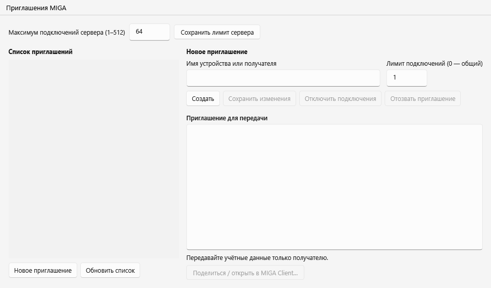
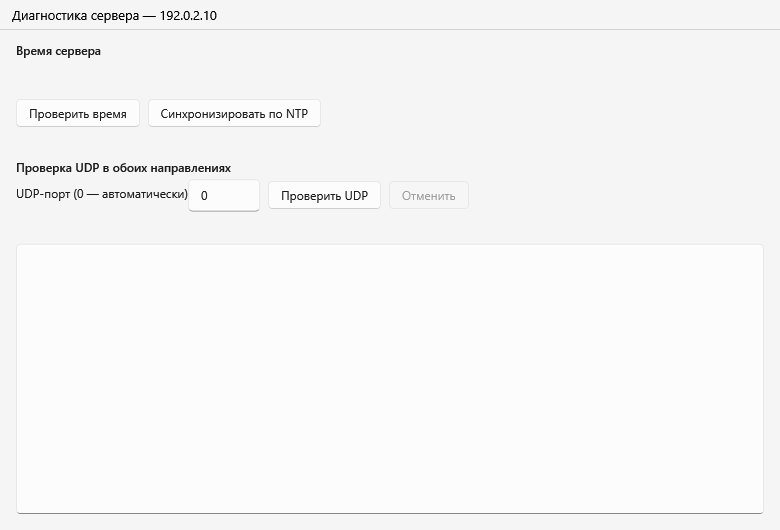
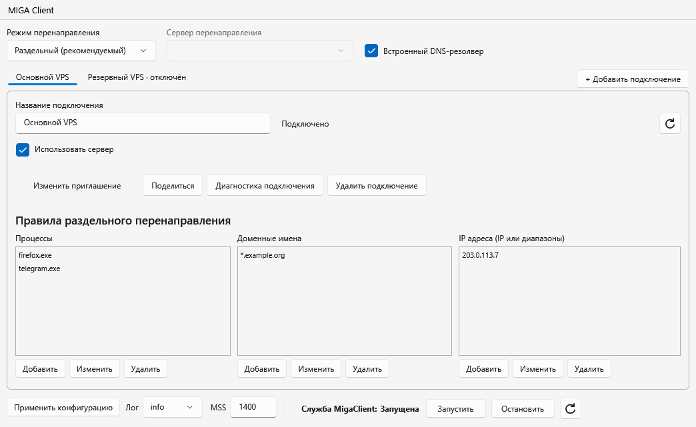
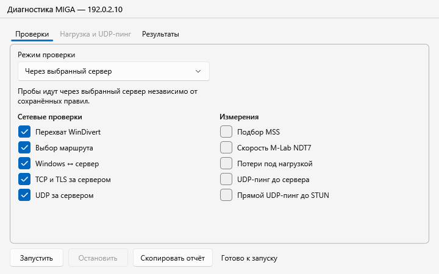
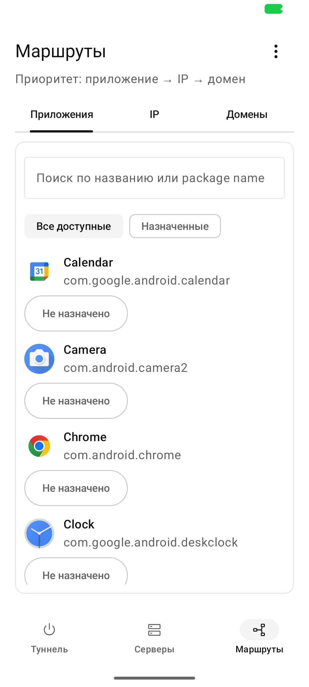

# Make Internet Great Again (M.I.G.A.)

## Общая информация

Приложение направляет выбранный IPv4-трафик TCP и UDP с Windows или Android через Linux-сервер. IPv6 и локальный трафик обычно идут напрямую.

Клиент получает доступ по персональному приглашению. Для установки сеанса используется Noise NK, для шифрования пакетов данных — ChaCha20. У пакетов данных нет криптографической проверки подлинности и защиты от повторной передачи.

MSI-установщик для Windows содержит MIGA Admin, MIGA Client и исполняемый файл серверного демона `miga_server` в формате ELF для Linux. Этот файл входит в компонент MIGA Admin для установки на VPS по SSH.

## Обзор MIGA Admin

MIGA Admin управляет Linux-серверами по SSH и выдаёт приглашения для клиентских устройств. Для установки выберите компонент **MIGA Admin** в MSI для Windows.

1. Нажмите **Добавить сервер**. Укажите название, адрес VPS, пользователя SSH и пароль. Нажмите **Подключиться**. Для установки сервера нужны права root.
2. На новом VPS нажмите **Загрузить и установить**. Поле выходного интерфейса можно оставить пустым для автоматического выбора по маршруту IPv4. Если служба остановлена, нажмите **Запустить**.
3. Откройте **Клиенты, приглашения и лимиты** → **Новое приглашение**. Введите имя устройства или получателя, укажите лимит одновременных подключений и нажмите **Создать**.
4. Нажмите **Поделиться / открыть в MIGA Client…**. Скопируйте приглашение, сохраните файл `.miga` или покажите получателю QR-код. Сделайте это до закрытия окна. Для каждого пользователя создавайте отдельное приглашение. Пользователь может использовать одно приглашение на разных устройствах. Число одновременных подключений по этому приглашению ограничено заданным лимитом.

Чтобы закрыть доступ, выберите приглашение в списке и нажмите **Отозвать приглашение**. Это также завершит его активные подключения.

### Диагностика сервера

Подключитесь к VPS по SSH и откройте **Диагностика сервера**. В окне видны версия сервера, состояние службы, IPv4-адреса, маршруты и прослушиваемые UDP-порты. Кнопка **Проверить время** показывает расхождение часов Windows и VPS и состояние NTP. При необходимости нажмите **Синхронизировать по NTP**.

Чтобы проверить доставку между компьютером с MIGA Admin и VPS, укажите свободный UDP-порт от 1024 до 65535 или оставьте `0` для автоматического выбора. Нажмите **Проверить UDP**. Результат показывает, сколько датаграмм дошло в каждом направлении. Если до VPS не дошла ни одна, обратное направление останется непроверенным.

## Обзор MIGA Client

MIGA Client для Windows управляет службой туннеля и правилами перенаправления. Компонент **MIGA Client** выбран в MSI по умолчанию.

1. Откройте MIGA Client и нажмите **+ Добавить подключение**. В меню **Настроить** выберите **Файл** для приглашения `.miga`, **Текст** для вставки приглашения или **Изображение QR-кода**. Убедитесь, что на вкладке отмечено **Использовать сервер**.
2. Выберите режим перенаправления. В **раздельном** режиме задайте на вкладке нужного сервера имена процессов (например, `firefox.exe`), IP-адреса или диапазоны, домены или маски вида `*.example.com`. Сначала проверяется имя процесса, затем статический IP, затем IP из DNS-ответа для указанного домена. В **полном** режиме выберите **Сервер перенаправления** для всего публичного IPv4-трафика TCP и UDP.
3. Нажмите **Применить конфигурацию**. Если служба **MigaClient** остановлена, нажмите **Запустить** внизу окна. Состояние туннеля отображается на вкладке сервера.

Встроенный DNS-резолвер включён по умолчанию в раздельном режиме и использует виртуальные адреса из `198.18.0.0/15`. Если этот диапазон занят в вашей сети, снимите флажок **Встроенный DNS-резолвер** и примените конфигурацию.

### Диагностика подключения

На вкладке сервера нажмите **Диагностика подключения**. Выберите режим, отметьте проверки и нажмите **Запустить**. Результаты доступны на вкладке **Результаты**, полный отчёт — по кнопке **Скопировать отчёт**.

- **Через выбранный сервер** — проверяет перехват пакетов, маршрут, связь Windows с VPS и доступность TCP/TLS и UDP за сервером. Дополнительно можно измерить скорость, задержку UDP и потери под нагрузкой.
- **По правилам перенаправления** — показывает, какой маршрут выбирают сохранённые правила. Для проверки конкретного приложения укажите его PID и во время проверки откройте в нём новое сетевое соединение. Без PID проверяется трафик диагностического процесса.

### Как выбрать MSS

Поле **MSS** в главном окне задаёт для всех серверов верхний предел размера данных TCP-сегмента в туннеле. Значение по умолчанию — **1400 байт**.

1. При активном подключении выберите **Через выбранный сервер**, отметьте **Подбор MSS** и нажмите **Запустить**. Сравните результаты **MSS до сервера** (Windows → VPS) и **MSS до внешнего узла** (Windows → VPS → Cloudflare STUN). Оба замера проверяют исходящее направление UDP-пробами без фрагментации. Предел в обратном направлении по короткому ответу определить нельзя.
2. Используйте строку **расчётный MSS**. Диагностика уже учла служебные данные. Если замер прерван или размер не подтверждён, повторите проверку до изменения настройки.
3. Если оба результата подтверждают текущий MSS, оставьте его. Если повторные замеры дают меньшее значение, введите наименьший из подтверждённых расчётных MSS. При нескольких VPS проверьте каждый используемый маршрут. Нажмите **Применить конфигурацию**, откройте новое TCP-соединение и проверьте передачу данных в обоих направлениях.

## Обзор Android-клиента

M.I.G.A. для Android 10 и новее использует системный VPN. Приложениям, IP-адресам и доменам можно назначать разные серверы.

1. На экране **Серверы** нажмите **+ Вручную**, укажите имя и вставьте текст приглашения или нажмите **Загрузить файл .miga**. Сохраните профиль. Для импорта с камеры выберите **QR-код** на экране **Серверы** и подтвердите добавление.
2. Откройте **Маршруты** → **Приложения**. Найдите приложение и выберите сервер в списке под его названием. Чтобы направлять через сервер трафик по адресу или домену, откройте вкладку **IP** или **Домены** и нажмите **Добавить правило**. Приоритет правил — приложение, IP, домен.
3. На экране **Туннель** нажмите **Включить**. При первом запуске подтвердите системный запрос Android на создание VPN-подключения. Состояние и счётчики пакетов доступны в **Диагностике**.
4. Чтобы изменить серверы или правила, выключите туннель. После сохранения изменений включите его снова.

